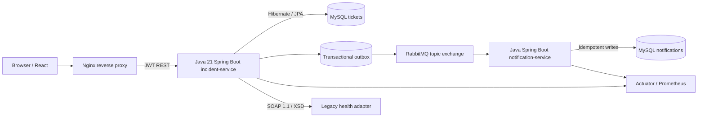

# AegisOps — Enterprise Incident, Problem & Change Management

**Independent full-stack Java engineering portfolio project.** Not an Indian Navy / WESEE / Optum product. No military data, systems, branding or confidential code are used.

AegisOps is a **runnable source-code demonstration** of an enterprise service-management platform, designed to map directly to Java/Spring Boot full-stack engineering job responsibilities: incident/problem tickets, service ownership, triage, SQL persistence, role-based access, secure REST APIs, async microservices, container deployment, monitoring, tests and production support.

> **Verification honesty:** The source is provided as a runnable project, but this generation environment did **not** have Docker/Maven/Maven Central dependencies available to execute its full container stack. CI and local builds must pass before describing it as deployed or production-tested. No fabricated uptime, user count, benchmark or deployment claims.

## Architecture



### Technology

| Layer | Demonstrated technology |
| --- | --- |
| Backend | Java 21, Spring Boot 3.5.16, Spring MVC, REST API, DTO validation; Spring WS SOAP adapter |
| Data | MySQL 8.4, Spring Data JPA, Hibernate, Flyway SQL migrations, pagination/filtering, optimistic locking |
| Identity | Spring Security, BCrypt, HMAC-signed JWT, role-based permissions (ADMIN/ENGINEER/VIEWER) |
| Operations | Incident/problem/change workflows; P1–P4 SLA deadlines; investigation comments; audit history |
| Async microservices | RabbitMQ, publisher confirms, transactional outbox, idempotent consumer, dead-letter queue |
| Frontend | React, Vite, responsive dashboard, accessible forms, login, filtering, ticket detail panels |
| DevOps | Multi-stage Dockerfiles, Docker Compose, non-root Java runtime, Nginx reverse proxy |
| Monitoring | Spring Actuator health, Prometheus exporter, optional Prometheus scrape stack |
| CI/CD | GitHub Actions Maven tests and frontend build; Jenkins declarative pipeline |
| QA | JUnit 5 / Mockito unit tests; API smoke tests and architecture constraints |

### Key design choices

- **JWT**: Short-lived signed tokens (30 minutes). Passwords hashed using BCrypt. Auth secret comes from environment, never source code.
- **RBAC**: Read actions require authentication; write/update/comment require ENGINEER or ADMIN; user provisioning requires ADMIN.
- **SLA**: P1 = 1h, P2 = 4h, P3 = 24h, P4 = 72h. This is illustrative policy, not a standard or certified SLA.
- **State transitions**: Open → Investigating/Resolved → Closed; reopening a resolved ticket is possible. Closed tickets are terminal.
- **Concurrency**: `@Version` optimistic locking and client version checks prevent silent overwrites.
- **Outbox**: Ticket state and a pending event are written in the same database transaction; scheduled publisher sends and marks delivery after broker ACK.
- **At-least-once**: Notifications store a unique `event_id`; retries are deduplicated. For multi-instance deployments, enhance outbox publisher with database claiming/leases.
- **Web access**: nginx proxies `/api` to Java backend, eliminating the need for unrestricted CORS.

## Prerequisites

- Docker Engine + Docker Compose V2, recommended for full stack.
- Or Java 21, Maven 3.9+, MySQL 8+, RabbitMQ 3.x and Node 22+ for manual service runs.

## Run entire stack with one command

```bash
cp .env.example .env
# Change ALL five values in .env to secure, unique secrets.
docker compose up --build -d
docker compose ps
```

Open **http://localhost:8088** and sign in using values from `.env` (`BOOTSTRAP_ADMIN_USERNAME`, `BOOTSTRAP_ADMIN_PASSWORD`). Only loopback (`127.0.0.1`) is published; do not expose this development configuration directly to the public internet.

**Optional Prometheus dashboard:**
```bash
docker compose --profile observability up -d prometheus
# http://localhost:9090
```

Stop:
```bash
docker compose down
# Only if intentionally deleting all demo data: docker compose down -v
```

### API demo (replace credentials with your `.env` values)

```bash
curl -s http://localhost:8088/actuator/health

TOKEN=$(curl -s http://localhost:8088/api/auth/login   -H 'Content-Type: application/json'   -d '{"username":"admin","password":"YOUR_PASSWORD"}' | python3 -c 'import json,sys;print(json.load(sys.stdin)["accessToken"])')

curl -s -X POST http://localhost:8088/api/tickets   -H "Authorization: Bearer $TOKEN" -H 'Content-Type: application/json'   -d '{"type":"INCIDENT","title":"API latency degradation","description":"5xx errors after a rollout; start root-cause analysis.","serviceName":"payments-api","priority":"P1"}'

curl -s -H "Authorization: Bearer $TOKEN" 'http://localhost:8088/api/tickets?size=20'
# Provision a least-privilege account:
curl -s -X POST http://localhost:8088/api/admin/users   -H "Authorization: Bearer $TOKEN" -H 'Content-Type: application/json'   -d '{"username":"engineer1","password":"CHOOSE_ANOTHER_LONG_PASSWORD","role":"ENGINEER"}'
```

After creating a ticket, inspect `docker compose logs notification-service` and the MySQL table `aegisops_notifications.received_events` to confirm async delivery. Bearer tokens are illustrative; use a BFF/OIDC flow for internet-facing production authentication.

### SOAP interoperability demo

The synthetic legacy adapter exposes a **SOAP 1.1/WSDL** service at `http://legacy-soap-adapter:8083/ws`, with a generated `legacy.wsdl` inside the Docker network. Once a ticket exists, issue `GET /api/tickets/{id}/legacy-health` with your Bearer token to invoke the adapter. It returns deterministic `NOMINAL` or `DEGRADED` example values, **not actual infrastructure health**.

## Test and quality checks

```bash
cd services/incident-service && mvn -B test
cd ../notification-service && mvn -B test
cd ../legacy-soap-adapter && mvn -B test
cd ../../web && npm install && npm run build
```

An executable end-to-end Bash smoke script lives at `scripts/smoke.sh`. Run it after `docker compose up --build -d`.

GitHub Actions is in `.github/workflows/ci.yml`. Jenkins integration is demonstrated via `Jenkinsfile` (requires Maven, Node and Docker tools configured on the runner).

### Live demo checklist before putting this on a resume

- [ ] Docker containers built and all services healthy.
- [ ] Login successful with new, secret environment credentials.
- [ ] Role restriction tested (VIEWER blocked from creating tickets).
- [ ] Created P1 incident persisted and appeared in React dashboard.
- [ ] Updated to INVESTIGATING; stale version returned HTTP 409.
- [ ] Comments and audit history visible.
- [ ] RabbitMQ event appears once in notifications DB after retry.
- [ ] Maven tests and npm build passed; CI is green.
- [ ] Screenshots or recording show a complete workflow.
- [ ] GitHub repository is actually published and all links work.

## Production hardening still needed

This is a portfolio demonstrator, **not** an audited production system. For real deployment: TLS at the edge, OIDC/OAuth2 provider with token rotation, HTTP-only secure session strategy, API rate limiting, secret manager, password reset, secure account lifecycle, network policy, full integration tests/Testcontainers, SAST/dependency and container scanning, load testing, DB backups, deployment rollback, alerts, exhaustive event delivery failure handling, distributed tracing, per-tenant isolation if multi-tenant, and authorization boundaries on every data object.

## Resume positioning (ONLY after running and verifying)

**AegisOps — Java Spring Boot Enterprise Incident Platform** | Java 21, Spring Boot, React, MySQL, Hibernate, Spring Security, JWT, Docker, RabbitMQ, Jenkins

- Developed an incident/problem/change management platform with Spring Boot REST APIs, React dashboard, MySQL/Hibernate persistence, Flyway migrations and priority-based SLA workflows.
- Implemented JWT/RBAC, BCrypt, audit trails, optimistic locking and async ticket events using RabbitMQ and the transactional-outbox pattern; containerized services with Docker Compose and added JUnit/Mockito tests plus CI/CD pipelines.

Never claim it was built at WESEE, deployed for Optum, used by a production customer, or handled real operational tickets unless separately true.

## Role match: Optum 2382838

| JD requirement | Supporting project evidence |
| --- | --- |
| Java / Spring Boot | `services/incident-service`, `services/notification-service` |
| ReactJS / UI | `web/src/App.jsx`, `web/src/style.css` |
| REST web services | Ticket and authentication controllers |
| MySQL / Hibernate / Spring | SQL migrations, JPA entities, repositories and services |
| Security | JWT signature verification, roles, password hashing |
| Microservices and deployment | 3 Spring services (2 data services + SOAP adapter), RabbitMQ, Docker Compose, Nginx |
| CI/CD and Jenkins | `.github/workflows/ci.yml`, `Jenkinsfile` |
| Design / dev / integration / QA | Clear layers, JUnit/Mockito tests, smoke script |
| Incident + Problem tickets | `TicketType`, P1–P4, workflow/audit endpoints |
| SOAP | `legacy-soap-adapter`, generated WSDL/XSD, `LegacySoapController` SOAP integration |
| Oracle/PLSQL | **Not implemented; keep as existing familiarity only** |

## Licence

MIT. Project is independent, educational and synthetic/demo-only. No proprietary employer material.

### Spring Boot release lifecycle

Spring Boot 3.5.16 was the final open-source maintenance release of the 3.5 series (June 2026). This portfolio version is pinned for compatibility with Spring Boot 3-era APIs. **Before internet-facing production use, upgrade to a currently OSS-supported Spring Boot branch and retest all integrations.**
